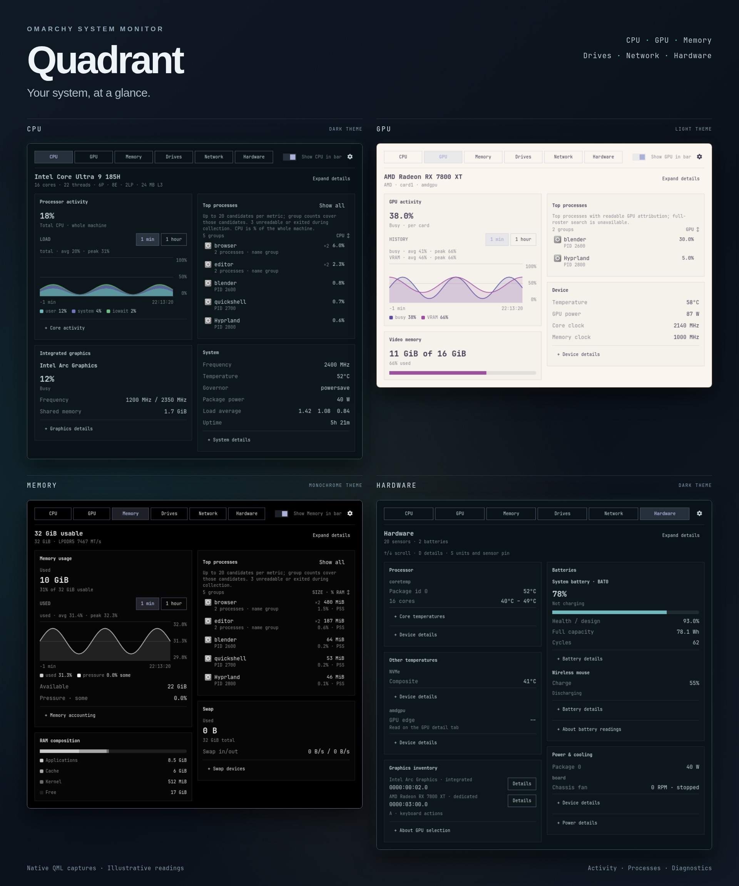
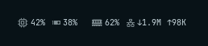

# Quadrant

<p align="center">
  
</p>
<p align="center"><em>CPU, GPU, and Memory — one plugin, your Omarchy palette.</em></p>

A unified system monitor for the Omarchy Quattro bar: CPU, GPU, memory,
drives and network in one compact bar slot and one tabbed panel. Each tab
identifies the hardware it measures, shows live usage and history, and
lists the processes behind the numbers.

- CPU topology and per-core load, RAM composition and pressure, GPU
  usage, drive throughput and mount capacity, and network traffic.
- Last-minute graphs and an hour of saved history, shared across monitors,
  with labelled duration controls and optional aligned GPU or mirrored traffic plots.
- Searchable CPU, memory, and disk I/O process groups, with memory sizes and member counts.
- Per-process CPU, memory, disk I/O, TCP traffic, and GPU metrics where
  available; see [measurement sources and limits](docs/METRICS.md).
- Independent bar segments, keyboard navigation, device pickers, and an
  inline settings view that follows the active Omarchy theme.
- Optional minute trends beside bar values, with saved segment ordering.
- Copy local addresses and MAC values, or open mounted volumes from the panel.

<p align="center">
  
</p>

See the [tab and settings screenshots](docs/USAGE.md#screenshots).

## Requirements

Supports **Omarchy 4.0.3 and later**, with Quattro's plugin service and
settings APIs. Requires `bash` ≥ 5, `jq`, `python3`, `ss` and `ip`
(iproute2), coreutils (`df`, `timeout`, and filesystem utilities), and
`awk` (mawk or gawk). The sampler needs a writable `$XDG_RUNTIME_DIR`,
as provided by a normal desktop session.

`nvidia-smi` is needed for NVIDIA monitoring. `lspci` (pciutils) is
optional and supplies AMD/Intel model names. Right-clicking the widget
opens `btop` through Omarchy's terminal launcher.

Copy buttons use `wl-copy` (wl-clipboard). Opening a mounted volume uses the
default file manager through `gio open` (GLib), or `xdg-open` when GIO is absent.

## Install

Quadrant is a third-party plugin and runs unsandboxed with your user
permissions. Review the repository before enabling it.

### From the Omarchy menu

1. Open the Omarchy menu.
2. Choose **Setup → Plugins → Add**.
3. Enter:

   ```text
   https://github.com/BVisagie/omarchy-quadrant.git
   ```

4. Read and accept Omarchy's plugin warning, then choose whether to enable
   Quadrant.

### From a terminal

```sh
omarchy plugin add https://github.com/BVisagie/omarchy-quadrant.git
```

Without `--enable`, Omarchy asks whether to enable the plugin after cloning
and validating it. Choosing no lets you inspect the installed checkout at
`~/.config/omarchy/plugins/dev.bvisagie.quadrant/` first. Enable it later
with:

```sh
omarchy plugin enable dev.bvisagie.quadrant
```

The widget starts in the right bar section (`barWidget.defaultSection`).
Move it with `omarchy bar move dev.bvisagie.quadrant --section center`.

### Update

```sh
omarchy plugin update dev.bvisagie.quadrant
```

Omarchy shows the incoming diff and asks for confirmation, then
fast-forwards the installed checkout and validates it. An invalid update
is rolled back.

### Uninstall

From the Omarchy menu, choose **Setup → Plugins → Remove**, then select
**Quadrant**. Or from a terminal:

```sh
omarchy plugin remove dev.bvisagie.quadrant
```

Omarchy disables Quadrant before removing its git checkout. Saved graph
history remains under `$XDG_STATE_HOME/dev.bvisagie.quadrant/` (normally
`~/.local/state/dev.bvisagie.quadrant/`). See [stored data and cleanup](SECURITY.md#stored-data)
for the history file and temporary sampler state. Installation and removal
do not require sudo or pkexec.

## Getting started

Click a bar segment to open its tab; clicking the same segment again
closes the panel. Click elsewhere in the slot to reopen the last-used tab.
Use `←` / `→` to switch tabs, **1 min** / **1 hour** or uppercase `H` to
switch the panel's graphs together, `S` or the gear to open settings, and `Esc`
to close settings or the panel.

The default bar shows CPU, dedicated GPU, memory, and network. Without a
dedicated GPU, Drives appears after Memory instead of the GPU segment;
integrated graphics appear on the CPU tab. Use each tab's **Show … in bar** switch
to change what appears.

In settings, use the segment arrows to change their order and choose
**graph + text** to add minute trends. Text remains the default; hidden or
temporarily missing devices keep their saved positions. See
[bar styles and ordering](docs/SETTINGS.md#bar-styles-and-ordering).

## Documentation

| Guide | Contents |
| --- | --- |
| [Usage](docs/USAGE.md) | Bar and panel controls, graphs, process rows, IPC, screenshots |
| [Settings](docs/SETTINGS.md) | Every setting, defaults, validation, and CLI examples |
| [Measurements](docs/METRICS.md) | Data sources, calculations, hardware support, and attribution limits |
| [Security](SECURITY.md) | User permissions, process data, stored files, and helper behavior |
| [Development](docs/DEVELOPMENT.md) | Architecture, checks, rendering, and the manual test matrix |
| [Changelog](CHANGELOG.md) | Release history |

## License

MIT — see [LICENSE](LICENSE).
