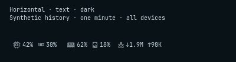
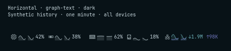
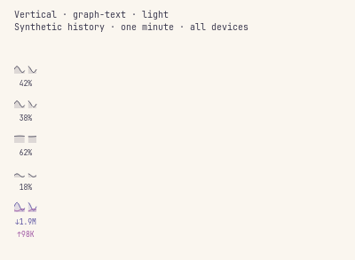
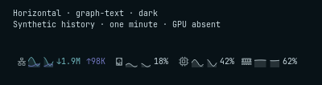

# Bar trends and ordering

[← Usage](USAGE.md#bar)

Text remains the compact default. The optional **graph + text** style adds
one minute of existing shared history without enabling new pollers. Each
percentage plot uses 0–100%; Network's two positive directions share a rate
scale with a 1 KiB/s minimum ceiling, named in the tooltip. Curves use the same
missing-value and collection-gap rules as the panel. The panel's hour choice
does not change the bar's minute window.

## Layout decisions

Each segment reserves its widest value, including `100%`, the estimated GPU
prefix for Intel, and bounded network rates. Horizontal values align left
beside their own glyph or trend, with unused space after the reading. A digit
count change can move the percent sign within its slot; outer width and cell
positions remain steady. A style, label, font, spacing, enabled-set, or selected
GPU vendor change can resize the widget. Graphs default to 32 logical pixels
and are bounded to 16–64 before shell spacing is applied.

Vertical bars place each trend above its value and clamp its width to the
strip. Network keeps separate down/up lines with complete units. A fixed font
size based on the widest possible reading fits those values into the strip;
it does not resize on each sample. All visible percentage cells share one
font size. A visible Intel GPU reserves `~100%`, including while its current
reading is measured or missing; AMD and NVIDIA reserve `100%`. A hidden Intel
GPU does not reduce the remaining cells' font size. In the captured 26 px strip
with Intel selected, percentage and network values use 8 px text. With AMD or
NVIDIA, percentages use 10 px and network values use 8 px. At the shell's
default 28 px strip, those sizes are 9/9 px for Intel and 10/9 px for AMD/NVIDIA.

The saved order contains all five resources independently of membership and
hardware availability. Missing GPU/Drives cells disappear without erasing
their positions. A GPU substitute uses **Drives' own saved position**, which
keeps the existing default after Memory. Explicit and substituted Drives
collapse into one cell. Toggling segments never persists the effective list.

Ordering arrows work by pointer or keyboard, including for disabled resources,
and retain focus on the moved resource. A missing GPU's switch keeps its saved
preference; the Drives switch represents its effective fallback or explicit
membership. See [Settings](SETTINGS.md#bar-styles-and-ordering) for validation,
reset, CLI, and downgrade behavior.

## Matched captures

These are actual offscreen QML captures using deterministic synthetic readings,
not hardware measurements. The two horizontal examples use the same five
enabled segments and canonical order at a 26 px bar size. The font, spacing,
data, and theme match; graph width is 32 px. Header text belongs to the capture
harness. Click an image for its original size.

| Style | Widget size | Capture |
| --- | --- | --- |
| Text | 269 × 26 px |  |
| Graph + text | 444 × 26 px |  |

The vertical light example uses Intel and keeps both network units visible.
An [AMD vertical capture](screenshots/bar-vertical-amd.png) shows full-size
percentage text when no estimate prefix is needed. The fallback
example saves Network, Drives, CPU, GPU, Memory; with GPU absent, the visible
order is Network, Drives, CPU, Memory, with one Drives cell.

<table>
  <tr>
    <td valign="top"></td>
    <td valign="top"></td>
  </tr>
</table>

The visual review covered dark, light, and monochrome palettes; both styles
and orientations; present/absent GPU; and 16/64 px graph widths (48 captures),
plus default-width, 1.25×/2× scaling, letter/no-label, and two-widget examples.
Native interaction tests separately check font size 18 and spacing scales
1/1.5/2, fixed positions, full value fit, and settings controls. Vendor fixtures
also cover both styles and orientations, 26/28/34 px strips, and a larger font,
including measured/estimated transitions and a disabled Intel GPU.

## Rendering observations

Recorded 19 October 2026 on an Intel Core Ultra 9 185H, x86-64, Quickshell
0.3.2 and Qt 6.12, using Qt's offscreen platform. Each case uses identical
synthetic minute histories, five segments, canonical order, one-second
updates, a three-second warmup, and a 10.01 s measurement. Runs were sequential.
The baseline is the merged text widget at `a260bf2`; the feature measurements
include the alignment and vendor-sizing corrections above. The model and
harness remain identical across cases. The harness includes a hidden settings
view in every case, so RSS includes the whole Qt/harness process.

| Case | CPU time | One CPU core | Peak RSS | Peak child processes |
| --- | --- | --- | --- | --- |
| Merged text baseline | 0.01 s | 0.10% | 115.84 MiB | 0 |
| Current text | 0.00 s | 0.00% | 120.00 MiB | 0 |
| One graph widget | 0.02 s | 0.20% | 126.49 MiB | 0 |
| Two graph widgets, shared service | 0.03 s | 0.30% | 126.83 MiB | 0 |

The local comparison budget for future runs on this fixture and machine is
less than 1% of one core at 1 Hz, no added child processes, and at most 10 MiB
RSS growth for the second graph widget. These observations fit that budget;
CPU sampling has 0.01 s resolution, so the text measurement's 0.00 s is below
that resolution. Allocator/cache variation affects separate processes; RSS
differences do not establish per-widget allocations. The observed
second-widget RSS increase is 0.34 MiB.

This measures UI rendering only. It does not establish full sampler cost,
collection duration, live sample gaps, layer-shell behavior on two physical
monitors, or GPU idle power. Native tests establish that the two widgets
resolve the same service and history objects without an embedded fallback;
the real Store smoke and stream fork checks cover existing collection
behavior separately. Hardware and power-management checks remain separate
work. Reproduce with the commands in [Development](DEVELOPMENT.md#bar-comparisons-and-rendering-cost).
