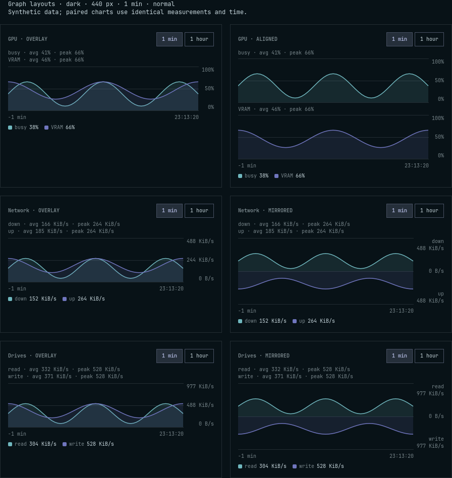
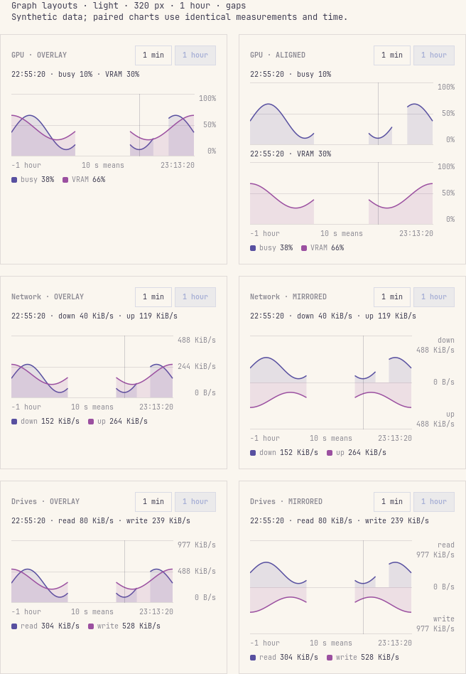
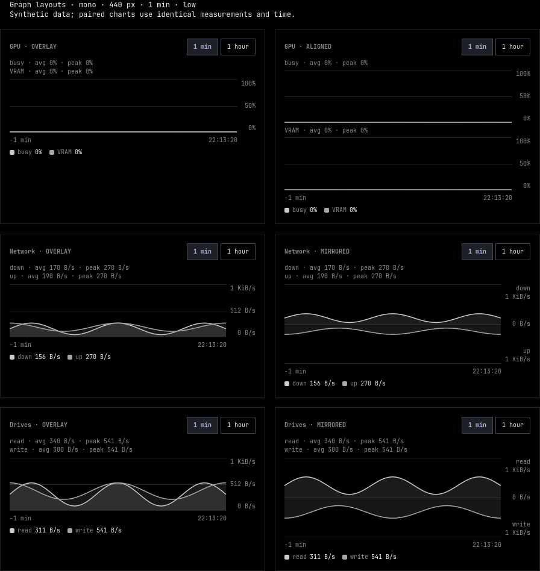

# Graph layout evaluation

[← Usage](USAGE.md#graphs-and-processes) · [Settings](SETTINGS.md#graph-layouts)

This implements the graph-alternatives part of the monitoring plan. GPU has
an aligned option; Network and Drives each have a mirrored option. Overlays
remain the default for all three. Optional bar trends and ordering belong
to the next deliverable.

## Default and height tradeoff

Paired renders use the same measurements, time window, graph width and
palette. With a 440 px outer panel (408 px graph), standard shell style,
and both series' summaries and live legends:

| Resource | Overlay block | Alternative block | Added height | Benefit |
| --- | ---: | ---: | ---: | --- |
| GPU | 196 px | 292 px aligned | 96 px | Busy and VRAM each get an unobscured full-height plot. |
| Network | 196 px | 240 px mirrored | 44 px | Download and upload occupy separate halves around zero. |
| Drives | 196 px | 240 px mirrored | 44 px | Read and write occupy separate halves around zero. |

These are graph blocks, including controls, summaries, time axis and legend;
they exclude the tab's hardware details and process list. Plot heights are
88 px for an overlay, two 88 px plots for aligned GPU, and 132 px for a
mirrored plot. Text wrapping, font and spacing settings can increase totals.
The same two-series fixture at 320 px outer width retained these heights.
Compared with the previous implementation's 162 px blocks at standard style and
408 px graph width, the default CPU/Memory blocks are now 182 px (+20 px),
and two-series GPU/Network/Drives blocks are 196 px (+34 px). The time axis
and additional series summary account for that default growth. Narrow or
larger-text layouts can reserve additional space for wrapped hover readings.

A GPU that has never reported a VRAM percentage shows only busy. Its aligned
setting falls back to the same 182 px single plot as the overlay. A known
percentage in the selected card's retained history keeps the VRAM series
through a failed poll; its live legend shows `--`. Changing hardware resets
that evidence through Store's existing history reset.

Overlays allow direct comparison of coincident peaks with the least panel
height. The alternatives separate overlapping curves more clearly,
especially in monochrome, but leave less space for device details and
processes. Mirroring gives each series 66 px vertically at standard style,
compared with 88 px in an overlay. Independent saved choices let each
resource use the appropriate tradeoff without expanding every panel by
default. GPU's aligned plots are useful when busy and memory usage follow
similar curves; mirrored rates are useful when direction matters more than
comparing overlaid shapes.

## Measurement contract

| Detail | Behavior in every layout |
| --- | --- |
| History | Same shared Store data and minute/hour selection; layout changes do not restart collectors or alter saved history. |
| GPU axes | 0–100% for busy and VRAM. Aligned plots share time endpoints, drawing width, scale and hover timestamp. |
| Rate axes | Zero-based shared magnitude scale across both series, including mirrored halves; ceiling is at least 1024 B/s and grows to cover either peak. Network can display bytes or bits. |
| Direction | Down/read above zero; up/write below in mirrored plots. Both halves label their series and positive ceiling; lower-half measurements stay positive. |
| Summary | Each series has its own named average and peak over visible, known measurements. CPU's complete stack retains a total. |
| Hour view | Plots contain 10 s means; average and peak summarize those buckets. The footer says “10 s means.” Fine-sample spikes cannot be recovered from bucket means. |
| Missing values | Null, missing and negative/unavailable values break the affected series. Measured zero is a real point. An incomplete CPU stack is unknown. |
| Collection gaps | The existing cadence-dependent threshold breaks runs. A lone reading remains a dot; long blank time gaps produce no hover reading. |
| Stale history | The axis ends at the last sample's local clock time, rather than “now.” The layout never extends a cached reading to the current clock. |
| Hover | Timestamped readings replace the summary above each plot. Space is reserved for the visible data before hover, keeping curves unobscured and the layout steady. |
| Controls | Duration buttons, uppercase H, summary click and plot wheel retain the panel's shared window. GPU hover on either aligned plot moves both readouts. |

## Matched captures

The captures below are real offscreen QML renders with **synthetic history**,
not hardware measurements. Each left/right pair has identical data and
width. The hour fixture represents 10 s means. Colors affect only a temporary
render process; no installed theme or user configuration is changed.

Dark, 440 px, one minute, overlapping series:

Light, 320 px, one hour, collection gaps, unknown values in the first series,
and the same hovered timestamp in each plot, shown in place of the summary.
A hole in busy/down/read does not erase the other series:

Monochrome, 440 px, one minute, low activity. Network and Drives retain a
1 KiB/s ceiling, so the small rates do not fill the plot:

## Verification and reproduction

`tests/render-graphs.sh` renders all three paired resources in one image.
The reviewed matrix covered dark/light/monochrome, 320/440 px outer widths,
minute/hour histories, and normal/gap/low/unknown patterns: 48 captures,
plus device scaling at 1.25 and 2. Axes, series separation, time alignment,
gaps, unknown values, low-activity scale and wrapped hover readings were
inspected in representative captures. Real tab renders cover CPU, GPU,
Memory, Drives, Network, Settings and Bar; this machine's dedicated-GPU
telemetry is absent, so the paired fixture establishes that graph's visual
comparison.

The Node graph tests check windowing, summaries, scales, runs, hover and
bucket semantics. Qt Quick Test exercises the actual graphs and settings,
including real Store-to-tab bindings and narrow/large-text layouts, in
both load-patch modes. Existing panel and process interaction suites remain
part of regression verification. See [Development](DEVELOPMENT.md#matched-graph-comparisons)
for commands and renderer controls.
