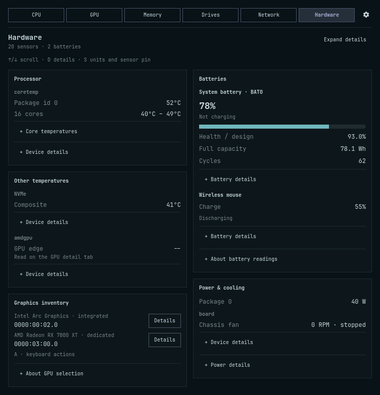

# Hardware diagnostics

[← README](../README.md)

The conditional **Hardware** tab lists temperature and fan channels, CPU
package power, and individual batteries or peripherals. On machines with
multiple GPUs, or a detected card without telemetry, it also lists each card
and its PCI identity. Hardware has no bar segment or separate history store.
An empty successful inventory leaves the tab hidden; a retained sensor pin or
collection error keeps it reachable for diagnosis.

## Sensors and units

The **Processor** card comes first for recognized CPU drivers. **Other
temperatures**, **Batteries**, and **Power & cooling** keep related readings
together. Sensors remain grouped by driver and owning device; known drivers
gain readable labels, while unknown drivers retain their names.
If different drivers share a friendly name, the raw driver distinguishes
them; multiple devices using one driver retain an owning-path suffix.

Reported core temperatures start with a count and temperature range.
One available temperature, or equal minimum and maximum readings, displays
a single value.
**Core temperatures** expands a grid with the original core IDs. Unavailable
and critical core counts remain visible when collapsed; critical status uses
each sensor's reported threshold. Package, drive and fan readings use compact
rows. **Device details** reveals the original driver and owning path once per group.
Unavailable, invalid and permission-denied readings remain visible beside
their sensor; grouping does not replace missing values with zero.
Duplicate labels from two chips remain separate. **Settings → Appearance →
Pinned sensor** highlights one discovered channel at the top of Hardware.
Its saved ID hashes the owning device, driver, and channel, with an NVMe serial
when available. Neither `hwmonN` nor the NVMe controller number establishes
identity. An absent pin stays saved and warns until **R** rediscovers it or
another sensor is selected. Moving hardware to a different physical path can
require selecting it again; hardware without a serial cannot distinguish an
identical replacement in the same location.
Chips are ordered by driver and owner, with numeric channel order within each
chip, so `temp2` precedes `temp10` and hwmon renumbering does not reorder them.

**Temperature unit** changes every panel temperature between Celsius and
Fahrenheit. Raw samples and critical thresholds stay in Celsius; conversion
happens only when formatting text. A temperature at or above its reported
critical threshold uses the urgent colour in either unit. Existing CPU and
Drives summary readings keep their restricted driver selection; a pinned
board sensor does not replace either reading.

Fan zero is shown as **0 RPM · stopped**. Missing, disabled, faulted, and
invalid readings show **--** with a reason where reported. A thermistor type
does not suppress a driver's converted temperature. Quadrant interprets
temperature inputs as millidegrees. The hwmon ABI also allows some external
thermistor channels to report raw millivolts; these need userspace conversion
and are not calibrated by Quadrant. It does not apply board-specific
libsensors tables or infer calibration requirements from `temp*_type`.
GPU-owned channels are identified but their input, fault, enable, type, and
critical files are left to the existing selected-GPU collectors. Hardware
shows **Read on the GPU detail tab** for those channels.
See the kernel's [hwmon ABI](https://docs.kernel.org/hwmon/sysfs-interface.html).

## Package watts and memory clocks

The CPU tab shows **Package power**, or **Packages total** when several CPU
packages are present, only when every package's energy and range files are
readable. CPU alone does not poll known unreadable counters or show a permanent
unknown total. Hardware still lists each package, including permission-denied
counters, for diagnosis. Startup/R checks access without opening the counters;
**R** picks up later permission changes. Readable `powercap` package energy
counters provide:

```text
watts = energy delta in microjoules / 1,000,000 / elapsed monotonic seconds
```

Timestamps belong to each counter read. The first reading is a baseline;
permission failures and unsupported counters stay unknown. Package domains
are counted once: core/uncore subdomains are excluded, and MSR/MMIO aliases
for a package select one source, preferring a readable counter. A total is
shown only when every discovered package has a valid rate. The powercap
`enabled` flag controls capping and is never changed or used to decide whether
an energy reading is valid. See the [powercap interface](https://docs.kernel.org/power/powercap/powercap.html).

Intervals under 100 ms, beyond three panel intervals plus two seconds, or
beyond 120 seconds require a new baseline. Source/range changes and ordinary
counter decreases also restart measurement. A decrease is treated as one wrap
only across the top and bottom 10% of the advertised range. A conservative
2,000 W ceiling per package rejects spikes and intervals that could hide a
complete wrap at that bound. An ambiguous interval is unavailable, never
clamped to zero. These are diagnostics, not billing-grade energy readings.

CPU package totals may include integrated graphics. Where RAPL package
inventory is absent or not fully readable, an existing AMD APU power reading
appears on CPU as **APU package**; it is not also presented as independent iGPU consumption.
Dedicated-card readings are labelled **GPU power**.

**Memory clock** is separate from **Core clock**. AMD uses the active
`pp_dpm_mclk` state; NVIDIA requests `clocks.mem` explicitly. An exposed but
unreadable/unsupported clock shows **--**. Without an identifiable source the
row is omitted; a core clock is never substituted. Reported MHz retain the
driver's clock convention, without guessing an effective transfer rate.
See [AMD DPM](https://docs.kernel.org/gpu/amdgpu/thermal.html) and
[NVIDIA SMI](https://docs.nvidia.com/deploy/nvidia-smi/index.html).

## Battery and GPU scope

The shell's Power panel already covers its main battery, charge, cycles,
power, and power profiles. Hardware supplies a different diagnostic task:
compare **individual system batteries and peripheral batteries** with the
same unit and missing-value rules. It does not manage profiles or add charge
history, notifications, or another battery bar widget.

Each present `power_supply` Battery gets its own rows for charge, full/design
capacity, health, cycles, power, and reported status. System charge is prominent,
with a neutral progress bar; peripheral charge uses compact rows. **Battery
details** holds full identity, design capacity and power. Live updates preserve
open detail sections. Scope distinguishes a
peripheral (`scope=Device`) from a system battery; a missing scope defaults to
system battery. No multi-device total is calculated. Health
is full/design from a matching pair of energy counters (Wh), or charge counters
(Ah); the displayed capacities use that same pair. Wh and Ah are never mixed.
Charge can fall back to a matching now/full ratio. `power_now` is preferred;
voltage × current is labelled **estimated**. A real zero stays zero, while
missing health, cycles, or power stays **--**. Peripheral drivers often expose
charge alone. See the [power-supply ABI](https://docs.kernel.org/power/power_supply_class.html).

Before a battery sample arrives, its status says **Waiting for a reading…**.
A sampled battery without charge reports **Charge unavailable**, followed by
its status when present. A reported 0% remains a real charge reading.

The existing GPU selectors already choose a live card. **Graphics inventory**
adds role and PCI identity across cards, including known-vendor devices that
the existing telemetry gate excludes. **Details** opens the existing CPU iGPU
view or dedicated GPU tab for its current card without saving a pin, preserving
`auto`. A different card has **Select**, which saves that card as the shared
selection and opens its view. Selecting a dedicated card also changes the
GPU bar segment; selecting integrated graphics changes the CPU iGPU choice.
An unavailable card has a disabled action with an explanation; **R** refreshes
detection. There is no aggregated
GPU percentage, no new polling of every card, and no overview on a single
fully supported GPU machine. **A**, arrows, and Enter/Space operate these
actions; outside action selection, up/down scroll Hardware. Shell Tab and Esc
keep their existing meanings.

## Collection and bounds

One serialized `hardware-info.py` sampler serves every monitor through the
shared Store. Startup and **R** request `list` metadata. A visible Hardware
tab requests `sample` at `panelIntervalMs`; CPU alone requests `power` when
all discovered package counters and ranges are readable. That mode does not
walk hwmon or batteries; CPU with absent or unreadable package counters adds
no hardware polls. Closing the last relevant viewer stops polling and clears
rates/baselines. A helper already running can finish, but
its result is discarded after a visibility, mode, or refresh generation change.
Refresh and timer requests coalesce behind the active helper. Settings retains
the underlying tab's viewer flag, consistent with other detail collectors.

Discovery caps at 128 sensors, 16 batteries, 16 packages, and 512 entries per
directory. Reaching a bound produces a visible truncation note. Identity and
live maps are separate, so a value update does not recreate sensor controls.
Hardware collection uses the normal sampler watchdog, does not spawn vendor
tools, and never writes permissions, limits, fan controls, or runtime power
controls. Counter baselines live only in memory. Hardware diagnostics and memory
clocks add no history writes or streaming tick work.

AMD runtime power-management work remains deferred to a future PR; see the
[detailed follow-up scope, design considerations, and hardware test procedure](AMD_RUNTIME_POWER.md).
The current implementation retains the existing GPU collection paths. Fixture tests establish
parsing, units, visibility, counter failures, and UI behavior. The development machine confirms Intel
sensors and system/peripheral discovery, with package counters denied to the
user. Readable RAPL rates and AMD/NVIDIA memory clocks still need physical
hardware validation; fixtures are not evidence of runtime power behavior.

<p align="center">
  <a href="screenshots/hardware.png"></a>
</p>

The documentation capture uses synthetic hardware and contains no machine
serial numbers or peripheral identifiers.
