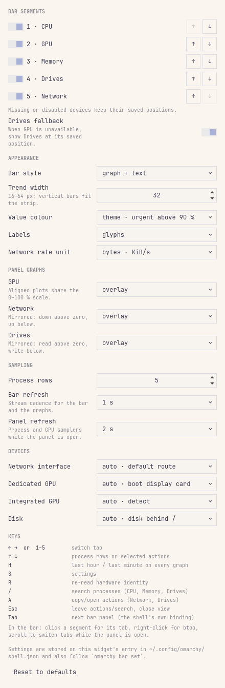

# Settings

[← README](../README.md)

Open settings with the panel's gear or `S`. Changes apply immediately.

Settings live inline on the widget's entry in `~/.config/omarchy/shell.json`
and are declared in the manifest schema. The settings view writes them
through the shell, typed; `omarchy bar set` works too and takes effect at
once:

```sh
omarchy bar set dev.bvisagie.quadrant processCount 8 --json
omarchy bar set dev.bvisagie.quadrant networkInterface '"wg0"' --json
```

Entries written by earlier versions (quoted strings, stringified lists)
are still read correctly and are rewritten in the typed form the first
time any setting is saved.

| Key | Default | Meaning |
| --- | --- | --- |
| `segments` | `["cpu","gpu","memory","network"]` | Bar segments to show; any subset of `cpu gpu memory disk network`. An empty list keeps a compact icon. |
| `processCount` | `5` | Top-process rows per tab (1–10) |
| `barIntervalMs` | `1000` | Stream cadence feeding the bar and the graphs (250–60000) |
| `panelIntervalMs` | `2000` | On-demand helper cadence (500–60000), including GPU polling for a visible bar segment |
| `networkInterface` | `"auto"` | `auto` = default route across IPv4 **and** IPv6, lowest metric wins, IPv4 takes ties; without a default route, the first non-loopback interface |
| `gpuDevice` | `"auto"` | Dedicated card for the GPU segment and tab: boot display card among detected dedicated GPUs, else `card0`, else the first detected dedicated card; or a specific `cardN` |
| `gpuDeviceId` | `""` | Persistent dedicated GPU pin, as a PCI address (`0000:03:00.0`); takes precedence over `gpuDevice` |
| `integratedGpuDevice` | `"auto"` | Which card is integrated graphics: `auto` (Intel at `00:02.x` or a known AMD APU), `none` (treat all cards as dedicated), or a `cardN` (force that card to be integrated) |
| `integratedGpuDeviceId` | `""` | Persistent integrated GPU pin, as a PCI address; takes precedence over `integratedGpuDevice`, including `auto` and `none` |
| `diskFallbackWithoutGpu` | `true` | Show Drives after Memory instead of GPU when no dedicated card is detected |
| `diskDevice` | `"auto"` | `auto` = physical disk backing `/` (LUKS/LVM folded), else the largest; or a sysfs name such as `nvme0n1` |
| `diskDeviceId` | `""` | Persistent whole-disk pin, as a basename from `/dev/disk/by-id`; takes precedence over `diskDevice` |
| `barPalette` | `"theme"` | `theme`, `heat`, or `vivid` (see [Bar](USAGE.md#bar)) |
| `barLabels` | `"glyph"` | `glyph`, `letter`, or `none` |
| `rateUnit` | `"bytes"` | Network panel and tooltip rates in `bytes` (KiB/s, binary) or `bits` (Mb/s, decimal); compact bar rates stay in bytes |

Every value is validated on read, whatever wrote it: numbers are clamped
to the ranges above, enumerations fall back to their default, device names
must look like a device (an interface name of at most 15 characters, a
`cardN`, a sysfs block name) or they become `auto`, unknown segment names
are dropped. Quadrant's settings view and IPC may only update the keys
listed here.
Persistent GPU IDs must have the PCI form `DDDD:BB:DD.F`; disk IDs contain
at most 255 safe basename characters and cannot contain paths, `..`, or a
`-partN` suffix. Invalid IDs become empty. IDs are looked up in inventory;
only resolved kernel names and device paths reach the samplers.
Unknown keys already present in the entry are preserved; settings at their
defaults are omitted when Quadrant saves. The helper scripts check their arguments again before touching anything.

## Device selection and bar fallback

The tab and settings pickers save a persistent ID when one is available,
so a disk or GPU can keep its pin when its kernel name changes. The old
name settings retain the currently resolved name for older Quadrant
releases. Those releases preserve the new ID settings as unknown keys;
their selection remains best effort until the newer release is restored.

Existing name-only pins are migrated when inventory resolves them. A name
left over from another boot cannot establish what it referred to before
the reboot: check the device once when upgrading a legacy pin. Missing
pins remain saved and produce a warning naming the target. `R` re-reads
GPU and disk inventory, updates the selectors, and resolves reappearing
devices without a shell restart.

If a GPU refresh fails, Quadrant keeps the last successful inventory and
readings and shows the detection error. A successful empty scan removes
the old hardware; a startup failure still reports unavailable inventory.

Choose `auto` in settings to clear both parts of a GPU or disk pin; choose
`none` to clear an integrated GPU pin and treat all cards as dedicated.
The Network tab also offers `auto`. Invalid kernel names fall back to
`auto`; `lo` is excluded from interface selection.

GPU pins identify a PCI location. Moving the card to a different slot
requires choosing it again. Saved GPU history also checks the PCI
vendor/device ID, subsystem ID, and revision when present, so a different
model in the same slot starts a new graph. Identical replacement hardware
cannot be distinguished by those fields. If the PCI vendor/device ID is
unreadable, the address can still pin the card, but its history is reused
only within the current boot.

Disk pins prefer WWN or NVMe EUI/UUID aliases, then device serial aliases
and namespace-specific NVMe names. Partition aliases are excluded. A
reported ID shared by multiple inventory rows is ignored; another unique
alias is used if available. Devices without a usable unique ID keep a
kernel-name pin and only reuse name-tagged history within the current
boot. Firmware clones whose collision is hidden by a single udev symlink
cannot be distinguished. The helper bounds inventory to 16 devices and
16 aliases per device.

Network interfaces remain pinned by name: predictable interface names
already describe the connection the user selected, and virtual interfaces
such as VPNs may have no hardware identity. Replacing an adapter without
changing that connection name keeps the selection and its history.

Without a dedicated GPU, `diskFallbackWithoutGpu` replaces a configured
`gpu` token with Drives for display without rewriting `segments`. Drives
uses its canonical position after Memory, rather than the GPU position. The
Drives tab's **in bar** switch controls that fallback in this case. It
also removes an explicit `disk` segment when switched off. To restore a
fallback segment, the configured list must still contain `gpu`.

Changing the selected interface or hardware identity starts that metric's
history afresh. Renumbering the same identified disk or GPU keeps its
history, while counter baselines and in-flight GPU results are reset.

## CLI examples

```sh
omarchy bar set dev.bvisagie.quadrant segments '["cpu","memory","network"]' --json
omarchy bar set dev.bvisagie.quadrant barPalette '"heat"' --json
omarchy bar set dev.bvisagie.quadrant rateUnit '"bits"' --json
omarchy bar set dev.bvisagie.quadrant diskFallbackWithoutGpu false --json
omarchy bar set dev.bvisagie.quadrant gpuDeviceId '"0000:03:00.0"' --json
omarchy bar set dev.bvisagie.quadrant diskDeviceId '"wwn-0x5002538e00000000"' --json
```

An ID takes precedence when loading settings or changing the ID itself,
even if its legacy name setting says `auto` or `none`. While Quadrant is
running, changing a name setting to `auto` (or integrated graphics to
`none`) clears its unchanged ID in the same settings write. Each of these
commands resets its device pin:

```sh
omarchy bar set dev.bvisagie.quadrant diskDevice '"auto"' --json
omarchy bar set dev.bvisagie.quadrant gpuDevice '"auto"' --json
omarchy bar set dev.bvisagie.quadrant integratedGpuDevice '"none"' --json
```

If an unresolved ID-only pin already has an `auto`/`none` policy, clear
its ID key directly or choose `auto` in settings. For example:

```sh
omarchy bar set dev.bvisagie.quadrant diskDeviceId '""' --json
```

Use `--json` for typed numbers, booleans, lists, and JSON-quoted strings.
See [IPC](USAGE.md#ipc) for the plugin's own `set` and `setBarSegment`
methods.

## Settings view

The settings view groups bar segments, appearance, sampling, and devices,
with keyboard help and a **Reset to defaults** action at the bottom.

<details>
  <summary>Show the full settings screenshot</summary>
  <p align="center">
    <a href="screenshots/settings.png"></a>
  </p>
</details>
