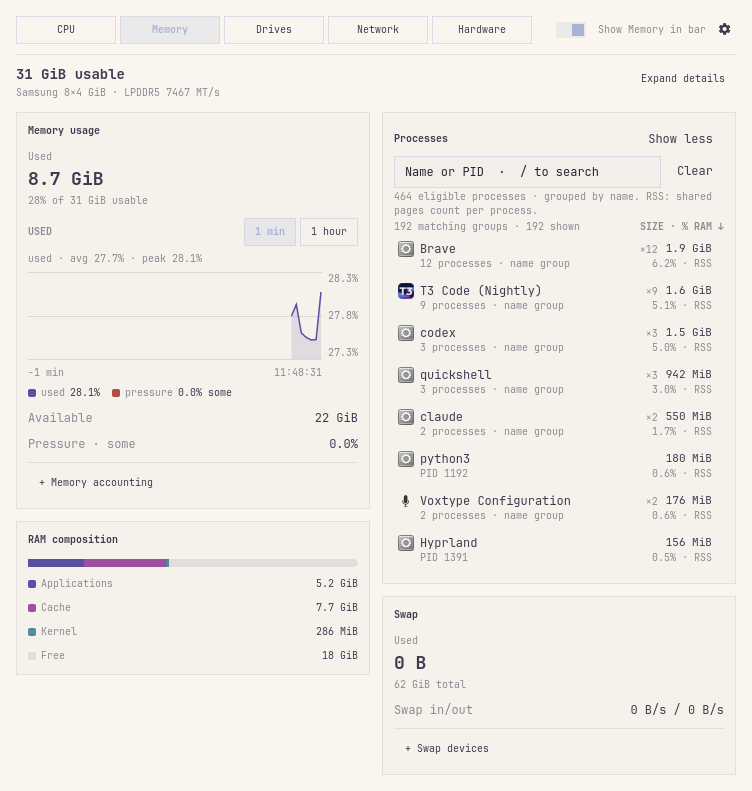
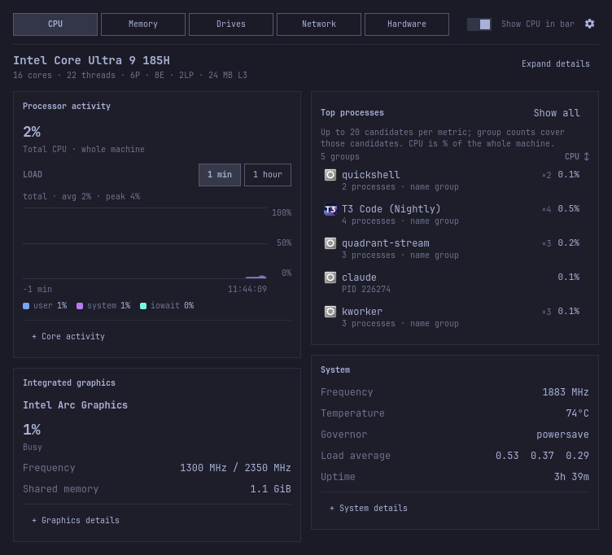
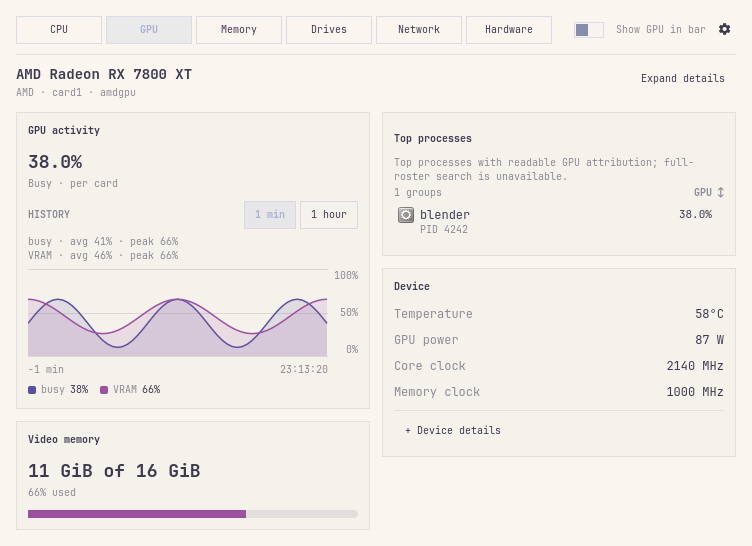
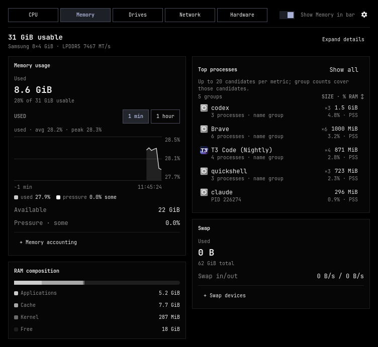
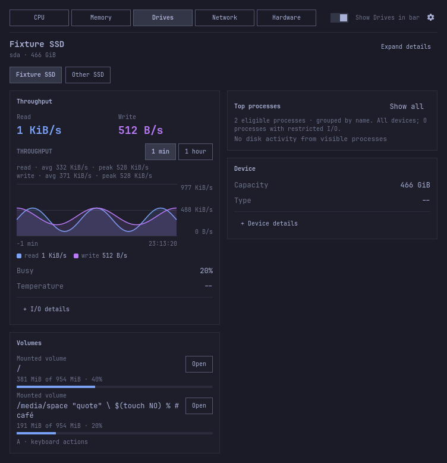
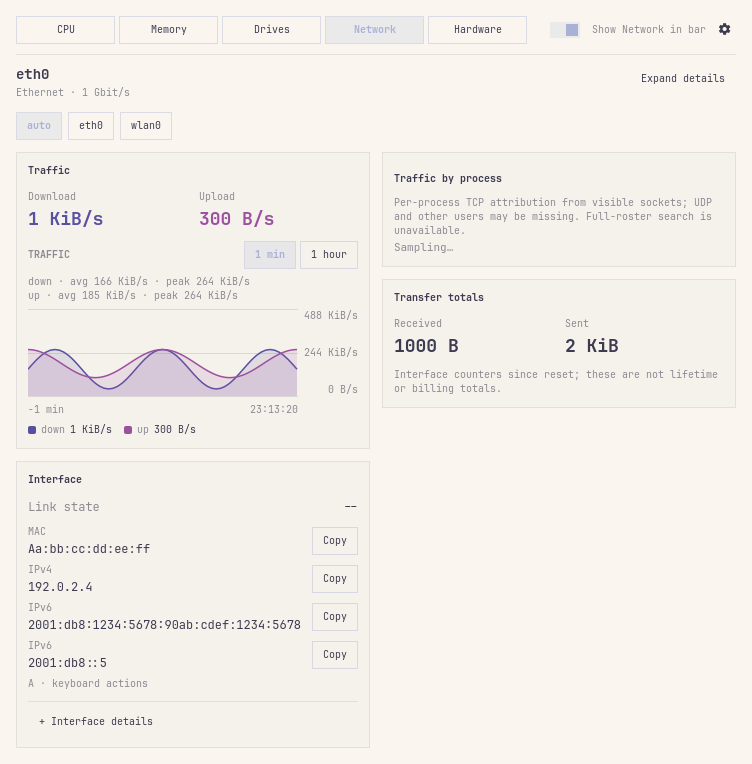

# Using Quadrant

[← README](../README.md)

## Bar

- **Segments**: CPU, GPU, memory, drives and network each pair a Nerd Font
  glyph (or `C`/`G`/`M`/`D`/`N` with `barLabels letter`) with a live value.
  Network shows compact `↓`/`↑` byte rates, down first. Vertical bars
  stack the segments and drop the glyphs. `barLabels none` hides labels.
  Each segment toggles independently from its tab's **in bar** switch or the settings view; unchecking every segment leaves a
  compact system-monitor glyph.
- **Style and order**: text is the default. Choose **graph + text** in settings
  for a minute trend beside each value, with a 16–64 px graph width. Vertical
  bars put the graph above the value and fit its width to the strip. Both
  network directions retain their units; vertical value text uses a fixed
  smaller font when necessary. Value slots reserve their widest reading,
  including `100%`, so samples do not move adjacent segments or widgets.
  Use the segment arrows in settings to reorder; disabled and missing
  resources keep their positions. Arrows support keyboard focus and activation.
- **Left- or middle-click a segment** to open its tab, switch to it, or
  close the panel when that tab is already showing. Left- or middle-click
  the slot padding or icon-only fallback to toggle the panel on the
  last-used tab. **Right-click** opens btop on either target. **Scroll**
  over the slot to switch tabs while the panel is open. Hovering a segment
  shows its tooltip.
- **GPU** is dedicated cards only; integrated graphics live on the CPU tab.
  When no dedicated card is detected, **Drives** substitutes at Drives' saved
  position (`diskFallbackWithoutGpu`), after Memory in the default order.
  An explicit Drives segment and a substitute produce one cell. A separate
  drives segment is off by default.
- **Colour** (`barPalette`): for percentage segments, `theme` uses the
  urgent colour at 90 % until the value drops below 80 %; `heat` ramps
  from muted through accent to urgent; `vivid` uses a fixed metric hue
  until the same hot threshold switches it to urgent. Network rates use
  the foreground in `theme`, the muted floor colour in `heat`, and a fixed
  network hue in `vivid`. With trends enabled, down and up use distinct theme
  colours matching their curves. Network rates never trigger hot colouring.

Bar trends always show the shared last-minute history, independently of the
panel's duration choice. CPU, GPU, memory, and Drives use a fixed 0–100% scale;
network down/up share a rate scale whose ceiling is shown in the tooltip.
Unknown values and long collection gaps leave breaks. See
[bar trend measurements](METRICS.md#bar-trends) and
[matched style captures](BAR_TRENDS.md).

## Panel

Tabs combine hardware identity, graphs, stats, and top processes. Hiding
a bar segment leaves its panel tab available. The GPU tab appears only
when a dedicated card is selected and available.
**Hardware** appears when additional sensors, package counters, batteries,
multiple GPUs, or unavailable cards are found. It lists per-device diagnostics;
a missing saved sensor or collection error also keeps it accessible. See
[Hardware diagnostics](HARDWARE.md) for pinning, units, and source limits.

Tabs use equal slots and wrap on narrow panels. The resource-specific
**Show … in bar** switch names its current target; the gear remains separate
from the tab strip. On wider panels, the switch shares the tab row. Device
choices wrap too, with full names in tooltips.

The panel prefers a theme-scaled width of 720 logical units, fitted to the
available monitor. Each resource uses framed groups, with headline readings
beside their graph or device. CPU, GPU, Memory, Drives and Network place
processes alongside activity; Hardware separates processor readings, other
temperatures, batteries, and power/cooling, with GPU actions when available.
Below the two-column breakpoint, content stacks without reducing the font.
The tab strip stays visible while the body scrolls to fit the screen.
Resizing preserves process search, selection and open detail sections.
**Expand details** beside the device identity opens the current tab's details;
**Collapse details** closes them. `D` performs the same action. CPU **Core activity**
and Hardware **Core temperatures** start collapsed. Hardware keeps the core
temperature range and any unavailable or critical reading counts visible.

| Key | Action |
| --- | --- |
| `←` `→` or `1`–`N` | switch tab (`N` = visible tabs; GPU is omitted without a dedicated card) |
| `↑` `↓` | move through process rows or selected actions; scroll the Hardware view |
| uppercase `H` | every graph: last hour ↔ last minute (the duration buttons, summary click, and graph wheel do the same) |
| `S` | settings view (gear in the header) |
| `R` | re-read system, GPU, disk, sensor, package, and battery inventory and refresh the active tab |
| `/` | open process search on CPU, Memory, or Drives |
| `A` | select Network/Drives actions or Hardware GPU Details/Select; `↑`/`↓` choose and `Enter`/Space activate |
| `D` | expand the current tab's visible detail sections, or collapse them when all are open |
| `Esc` | leave action selection, clear a search query or leave its editor, then close settings or the panel |
| `Tab` | keeps its Quattro meaning: switch to the adjacent bar panel |

These shortcuts apply while a metric tab is visible. In settings, use the
controls and close the view with the gear or `Esc`. The shell also maps
lowercase `h` / `l` to tab navigation and `j` / `k` to process-row navigation;
use uppercase `H` for history. While search has focus, printable keys enter
the query and normal editing/paste shortcuts apply. `Tab` still switches
bar panels. Press `↓`, `Return`, or `Enter` to select the first matching
group and navigate the filtered results without clearing the query; `/`
returns to the editor. Press `Esc` twice in the editor to clear a query and
return to navigation.

The last-used tab survives closing and reopening the panel within the
running shell. The history-window choice also stays until changed; closing
the panel closes the settings view and resets process search, expansion,
and the cursor.

In Hardware's graphics inventory, **Details** opens the current card's tab
without changing automatic selection. **Select** saves a different card for
the shared view; a dedicated-card selection also changes the GPU bar segment.
See [Hardware diagnostics](HARDWARE.md#battery-and-gpu-scope).

## Copy addresses and open volumes

On **Network**, each collected IPv4/IPv6 address and MAC value has a **Copy**
button. The complete displayed value is copied without an added newline;
IP values show the host address without the CIDR prefix. The existing inventory
includes up to eight global-scope addresses per interface; `R` refreshes it.
Copying never reads the clipboard or changes interface selection.

On **Drives**, each displayed mounted volume has an **Open** button. It checks
that the directory is still mounted and accessible, then sends a request to
your default file manager. Complete paths are retained even when the label
needs eliding; the button's tooltip and accessible name include the path.
Known inaccessible directories have a disabled button with the reason in its
tooltip. If a mount disappears or access changes after the last poll, activation
shows an error; `R` refreshes inventory. Keyboard activation of a disabled action
also explains why it cannot open.
The existing representative-mount grouping remains in effect.

Press **A** to select the first action, **↑/↓** (or `j`/`k`) to choose, and
**Enter** or **Space** to activate. **Esc** or **A** returns to normal navigation;
**Tab** still switches bar panels. Action selection follows the same value
through an inventory reorder, and clears if it disappears or its device changes.
Settings, search, tab changes, and panel close also leave action selection.
Selecting a process row returns keyboard navigation to processes.

Success and failure messages name the requested value and remain until the
next action or device-context change. File-manager success means the desktop
tool accepted the request. These actions run only when activated; opening a
tab, focusing a button, and refreshing inventory do not copy or launch anything.

The [Network](screenshots/network.png) and [Drives](screenshots/drives.png)
captures use synthetic local addresses and volumes to demonstrate these controls.

## Graphs and processes

Choose **1 min** or **1 hour**, click the average/peak summary, scroll over a
graph, or press uppercase `H` to switch every graph in that panel together.
Choosing the already selected duration leaves it unchanged. Each monitor
keeps its own choice for the session. Hovering a graph shows the readings at
that point with its local timestamp in place of the summary above the plot.
The reserved space keeps the graph steady and its curves visible. The summary
names each series: the CPU stack total, memory usage, GPU busy and VRAM, drive read and write,
or network down and up. In the hour view, **10 s means** identifies the
buckets; peak means the highest bucket average, so short spikes can be
lower than in the minute view. The time axis ends at the last sample's
local clock time, including when collection has stopped.

In **Settings → Panel graphs**, choose aligned GPU plots or mirrored
Network/Drives plots independently. GPU plots share time and a 0–100% scale;
hovering either aligned plot moves both readouts. Cards without a VRAM
percentage show only busy; a previously measured percentage in that card’s
retained history keeps the series through a failed poll. In mirrored plots,
down/read is above zero and up/write below it, with the same positive
rate scale on each side. Overlays remain the compact default. See
[graph layout comparisons](GRAPH_LAYOUTS.md).

Changing refresh cadence retains recent minute samples until their timestamps
leave the 60 s window, including samples collected at the previous cadence.

Memory's used value is total RAM minus the kernel's available estimate. Its
composition shows a separate physical-RAM breakdown, with an application
estimate after free RAM, cache, and kernel (unreclaimable slab). Used,
available and pressure appear in **Memory usage**, with separate **RAM
composition** and **Swap** groups.
Pressure prints the actual PSI percentage, without a gauge ceiling.
**Memory accounting** expands the explanation; **Swap devices** appears when
there are individual files or zram to show. Swap remains outside the
physical-RAM breakdown.

CPU, Memory, and Drives start with a compact top-consumer list. **Show all**
opens a searchable roster; **Show less** returns to the compact list. Search
matches the grouped name, desktop application name, or any member PID. A PID
match identifies that member while keeping the entire group's totals.
The `×N` badge counts covered processes with the same normalized name; it does
not establish application ownership or parent/child relationships. Compact
counts cover only the candidates named in the scope note. Unreadable and
short-lived processes can be missing even in the expanded view.

Click the metric heading to change order. Compact mode cycles stable roster,
descending value, and name; expanded mode switches value/name order. Selection
follows a surviving PID/start-time member as values reorder. Filtering out a
selected group clears the cursor. Samples preserve the first visible group
and its scroll offset when it moves less than one viewport, including when
the cursor is elsewhere. Larger rank changes keep the scroll position;
keyboard navigation and filtering still reveal the selected row. Expanded
results scroll within the list;
only visible rows have delegates. At most 256 groups are displayed at once,
after searching the entire collected roster. Refine the query when the result
count exceeds that limit.

Memory rows show size, percentage of usable RAM, and PSS/RSS accounting.
Expanded memory uses RSS; shared pages count in each process. Compact memory
uses PSS where readable, RSS otherwise; mixed groups say **PSS/RSS**. A `≥`
prefix and a measured-member count identify partial totals. **Measuring**,
**Restricted**, no activity, no match, and sampler errors are separate states.
A cold CPU/I/O reading normally becomes available after one shared follow-up
around 500 ms, instead of waiting for the next panel interval.

CPU, Memory, Drives, and attributed Network rows keep sparklines of up to
thirty collected samples. Unknown intervals leave gaps; a reused PID starts
fresh. Memory trends also restart when collected mode or PSS/RSS accounting
changes, so switching measurement bases does not create an artificial step.
GPU and **Other traffic** have no sparkline. Network keeps per-process
TCP rows plus **Other traffic**; GPU retains its own limited attribution and
same-name grouping. These tabs do not offer full-roster search.
See [measurement limits](METRICS.md) for what each process value represents.

<p align="center">
  <a href="screenshots/process-exploration.png"></a>
</p>

## IPC

The shell must be running with Quadrant enabled. Tab names in IPC are
`cpu`, `gpu`, `mem`, `disk`, `net`, and `hardware`; segment names are `cpu`, `gpu`,
`memory`, `disk`, and `network`. Unknown or unavailable tabs are ignored.
The `set` method takes its value as JSON text:

```sh
quickshell ipc -p "$OMARCHY_PATH/shell" call dev.bvisagie.quadrant showTab gpu     # cpu | gpu | mem | disk | net | hardware
quickshell ipc -p "$OMARCHY_PATH/shell" call dev.bvisagie.quadrant settings
quickshell ipc -p "$OMARCHY_PATH/shell" call dev.bvisagie.quadrant setBarSegment disk true
quickshell ipc -p "$OMARCHY_PATH/shell" call dev.bvisagie.quadrant set processCount 8
quickshell ipc -p "$OMARCHY_PATH/shell" call dev.bvisagie.quadrant set networkInterface '"wg0"'
omarchy-shell shell summon dev.bvisagie.quadrant '{}'   # open on last-used tab
omarchy-shell shell hide dev.bvisagie.quadrant
```

The plugin also exposes `open`, `close`, `show`, `hide`, and `toggle` IPC
methods. See [Settings](SETTINGS.md) for typed values and validation.

## Screenshots

These captures show the current panel across dark, light, and monochrome
Omarchy themes. GPU, Network, Drives and Hardware use fixture readings; CPU and Memory
sample the development machine. Click a screenshot to view it at full size.

<table>
  <tr>
    <td width="50%" valign="top">
      <p><strong>CPU</strong><br>Processor activity and top processes, with core details collapsed.</p>
      <a href="screenshots/cpu.png"></a>
    </td>
    <td width="50%" valign="top">
      <p><strong>GPU</strong><br>Dedicated GPU activity and VRAM.</p>
      <a href="screenshots/gpu.png"></a>
    </td>
  </tr>
  <tr>
    <td width="50%" valign="top">
      <p><strong>Memory</strong><br>RAM composition, pressure, and swap.</p>
      <a href="screenshots/memory.png"></a>
    </td>
    <td width="50%" valign="top">
      <p><strong>Drives</strong><br>Disk selection, throughput, and mounts.</p>
      <a href="screenshots/drives.png"></a>
    </td>
  </tr>
</table>

**Network** — interface selection, copyable MAC/IP values, download/upload
history, and TCP process attribution.

<p align="center">
  <a href="screenshots/network.png"></a>
</p>

The [Hardware guide includes a synthetic diagnostics capture](HARDWARE.md).
The [settings guide includes the full settings view](SETTINGS.md#settings-view).
